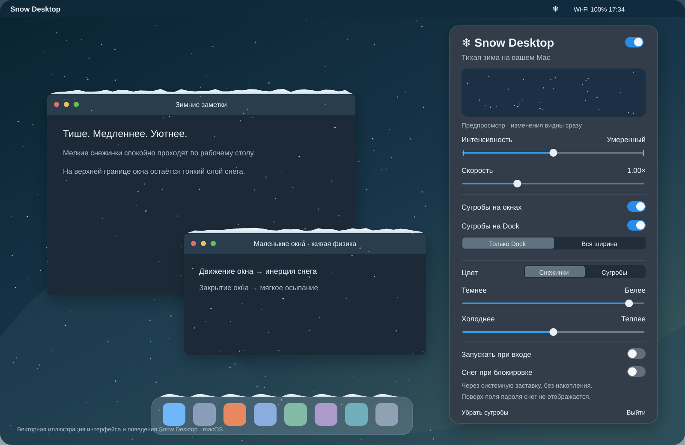
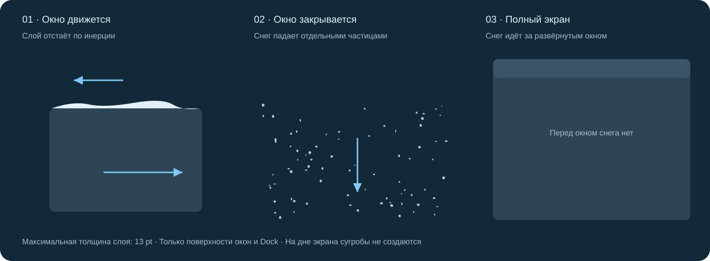

# ❄ Snow Desktop

Тихий снег для macOS. Часть потока идёт за окнами до Dock, поэтому верхние окна не перехватывают весь снег. Маленькие снежинки медленно опускаются на рабочий стол, собираются тонким слоем на небольших окнах и Dock и осыпаются при движении или закрытии окна. Все настройки находятся под снежинкой в строке меню.

**macOS 14+ · Swift / AppKit / Core Animation · без сторонних зависимостей**



*SVG выше — векторная иллюстрация реализованных настроек и поведения, а не скриншот. Фотографии из сторонних публикаций в проект не включены.*

## Что умеет приложение

- **Спокойный снегопад.** Частицы радиусом примерно 0,55–1,4 pt, мягкая прозрачность, небольшое плавное покачивание. Базовая скорость — 11–23 pt/с.
- **Три уровня интенсивности:** лёгкий, умеренный и густой. Ползунок имеет три фиксированные позиции.
- **Отдельная скорость:** от 0,35× до 2,5×. Интенсивность задаёт количество частиц, скорость — их движение.
- **Живой предпросмотр.** В маленькой области настроек работает тот же движок; плотность, скорость и оттенок меняются сразу. Плотность образца увеличена для удобства сравнения на маленькой площади.
- **Сугробы на окнах.** Слой ограничен 13 pt. У углов окна он плавно закругляется и сходит к нулю; вертикального среза нет. Поверхность сглаживается, а перепады высоты постепенно оседают.
- **Инерция.** При перемещении вправо снег отстаёт влево. У края материал срывается и падает вниз с ускорением; при закрытии, сворачивании или исчезновении окна оставшийся слой осыпается.
- **Перекрытия.** Снежинки проходят за рабочей областью любого окна. Сугробы остаются только сверху. Передние окна закрывают ровно пересекающуюся часть заднего сугроба, включая частичное перекрытие его высоты; активность окна на это не влияет.
- **Полный экран.** На полноэкранных и развёрнутых на всю рабочую область окнах снег не копится. Область такого окна маскирует и падающие частицы: снег остаётся за ним.
- **Dock.** По умолчанию снег лежит только в пределах нижнего Dock. По сторонам нет невидимого пола: частицы уходят за нижнюю границу и удаляются. Геометрия значков учитывает увеличение при наведении.
- **Режим «Вся ширина».** По желанию создаётся общая полка на системной высоте Dock по всей ширине дисплея; этот режим не требует доступа к значкам Dock. Отдельного режима накопления только по бокам Dock нет.
- **Два набора цвета.** Белизна и тёплый/холодный оттенок настраиваются отдельно для падающих снежинок и лежащего снега.
- **Автозапуск** через системный `SMAppService`, с учётом разрешения в настройках входа.
- **Несколько дисплеев**, прозрачные окна, сквозные клики. Приложение не перехватывает мышь и клавиатуру.



## Сборка и запуск

Нужны macOS 14 или новее и инструменты разработчика Apple. Для сборки приложения достаточно Command Line Tools:

```sh
xcode-select --install
./Scripts/build-app.sh
open "build/Snow Desktop.app"
```

В строке меню появится снежинка. Нажатие открывает нативный popover с переключателями, ползунками и предпросмотром — без меню с галочками.

Для постоянного использования перенесите `Snow Desktop.app` в `/Applications` **до включения автозапуска**. При переносе уже зарегистрированного приложения выключите автозапуск и включите его заново из нового расположения.

Сборка для обеих архитектур:

```sh
SNOW_ARCH=universal ./Scripts/build-app.sh
```

Скрипт собирает `.app`, вложенную заставку `.saver`, генерирует иконку и проверяет подпись. По умолчанию подпись локальная, ad hoc. Для распространения вне своей машины нужны Developer ID, hardened runtime и нотариализация Apple; готовая сборка здесь не выдаётся за нотариализованный релиз.

## Разрешения и Dock

Падающий снег и геометрия обычных окон работают без записи экрана. Приложение читает координаты окон через Core Graphics; изображения, содержимое и названия окон не запрашиваются. Нет сети, аналитики или сервера.

Для точных границ Dock и реакции на увеличение значков нужен **Системные настройки → Конфиденциальность и безопасность → Универсальный доступ → Snow Desktop**. Кнопка «Разрешить…» инициирует штатный запрос macOS. До выдачи доступа ограниченный режим «Только Dock» недоступен; «Вся ширина», снегопад и небольшие окна продолжают работать. В интерфейсе показывается фактический ответ Dock. Локальная ad hoc подпись привязана к хешу сборки. После обновления macOS может показывать старое разрешение включённым, но отклонять новый процесс. В таком случае удалите старую запись Snow Desktop и добавьте текущий `.app` заново кнопкой «+» в «Универсальном доступе», затем перезапустите приложение. Для сохранения разрешения между сборками используйте стабильную Apple Development / Developer ID подпись через `SIGN_IDENTITY`.

Поддерживается нижний горизонтальный Dock. Для бокового Dock накопление отключено. Автоматически скрытый Dock не создаёт полку за пределами дисплея.

## Снег при блокировке

В настройках есть отдельный переключатель **«Снег при блокировке»**. Он устанавливает `Snow Desktop.saver` только для текущего пользователя и открывает настройки заставки. Нужно выбрать **Snow Desktop** как системную заставку; установка модуля сама по себе не меняет выбранную заставку. При отключении удаляется только установленный этим приложением модуль Snow Desktop.

Заставка показывает только падающий снег на тёмном фоне, без сугробов и без доступа к окнам. Её интенсивность и скорость доступны в параметрах системной заставки отдельно от рабочего стола.

**Граница возможностей macOS:** разрешения на рисование обычного приложения поверх защищённого экрана входа не существует. Заставка работает, пока macOS показывает заставку, в том числе при включённом требовании пароля после неё. Когда система переключается к полю пароля или экрану FileVault до входа, снег не отображается. Это не обход экрана блокировки. Система может ограничивать частоту кадров заставки.

## Плавность и ресурсы

Анимация рабочего стола синхронизируется с дисплеем через `NSView.displayLink` и запрашивает его максимальную частоту. На 120 Гц движок рассчитан на обновление 120 раз в секунду; фактическую частоту выбирает macOS. При энергосбережении или перегреве частота снижается, при сне и неактивной пользовательской сессии отрисовка останавливается.

Физика использует фиксированный шаг 1/120 с. После сна нет длительного пересчёта пропущенных часов. Частицы, поверхности и сетки ограничены по количеству; для снежинок используются общие миниатюрные текстуры и повторно используемые слои, для сугробов — небольшие векторные полосы. Нет WebView, Electron или полноэкранного CPU bitmap на каждом кадре.

Целевой бюджет — **не более 0,5% физической RAM**: приблизительно 41 МБ на 8 ГБ, 82 МБ на 16 ГБ. В интерфейсе показывается текущий `phys_footprint` процесса и бюджет этой машины. Это измеряемая цель, а не гарантия на любых версиях macOS и конфигурациях дисплеев. Общие страницы фреймворков в RSS и память системного WindowServer учитываются отдельно. Любая анимация требует некоторого CPU/GPU.

Подробности, замеры и границы проверки: [docs/VALIDATION.md](docs/VALIDATION.md).

## Проверки

Проверка физики с одними Command Line Tools:

```sh
./Scripts/test-physics.sh
./Scripts/test-rendering.sh
```

С полным Xcode доступен также `swift test`. Проверяются посадка на полку, отсутствие пола по краям Dock, перекрытые участки, инерция, осыпание, предел высоты, скорость, ограничение количества частиц, пробуждение и пассивный режим заставки.

Дополнительные проверки:

```sh
# Создаёт небольшое тестовое окно, двигает и закрывает его за 12 секунд.
./Scripts/smoke-test.sh

# Пишет текущий физический footprint и параметры дисплея каждые 5 секунд.
open "build/Snow Desktop.app" --args --diagnostics /tmp/snow-desktop-diagnostics.json

# Замер CPU / RSS уже работающего процесса.
python3 Scripts/profile.py --pid <PID> --seconds 30
```

GitHub Actions запускает тесты и собирает универсальный `.app` в загружаемый ZIP-артефакт. Артефакт подписан ad hoc, без нотариализации.

## Устройство проекта

| Путь | Назначение |
| --- | --- |
| `Sources/SnowCore` | Независимые от AppKit геометрия, частицы, сугробы и физика |
| `Sources/SnowDesktop` | Строка меню, popover, отслеживание окон/Dock, Core Animation |
| `Sources/SnowScreenSaver` | Модуль системной заставки без накопления |
| `Tests/SnowCoreTests` | Сценарии физики, XCTest и самостоятельный runner |
| `Scripts` | Сборка, иконки, тестирование и замеры |
| `Tools` | Одноразовое тестовое окно и проверка загрузки заставки |
| `docs/images` | SVG-иллюстрации интерфейса и поведения |

Отслеживание окон намеренно использует только их геометрию. Определение максимизированного окна геометрическое; необычные приложения, нестандартные панели, Stage Manager и анимации Mission Control требуют отдельной проверки. Физика использует поле высот с частицами для осыпания, а не полный симулятор каждой снежинки в сугробе.

## Windows

Сейчас реализована только macOS-версия. Порт Windows — отдельный следующий этап. `SnowCore` не зависит от AppKit и отделён от платформенных механизмов окон, Dock и отрисовки.
